# Credit-Risk Modelling in R

Advanced credit-risk analysis on the **German Credit** dataset (UCI, 1,000 real
loans, 30% bad), written in R with the tidyverse. It compares three models and —
the part that matters in banking — chooses a **cost-sensitive decision
threshold** rather than a naive 0.5 cutoff.

**Stack:** R, dplyr/tidyverse, ggplot2, `glmnet` (L1-regularised logistic),
`mgcv` (GAM), `pROC`, `broom`, R Markdown.

## What it does
1. **Three models**, fit on a stratified 70/30 split:
   - Logistic regression (baseline)
   - **L1-regularised logistic** (`glmnet`), λ chosen by 10-fold cross-validation
   - **GAM** (`mgcv`) with smooth, non-linear terms on loan duration, amount and age
2. **Honest comparison** — scored once on the held-out test set (AUC + ROC).
3. **Cost-sensitive decision** — using the standard **5:1 cost matrix** (approving
   a bad loan costs 5× rejecting a good one), it finds the `P(bad)` cutoff that
   minimises expected cost.

## Verified results
| Model | Test AUC |
|---|---|
| Logistic | 0.752 |
| LASSO (glmnet) | 0.753 |
| **GAM (mgcv)** | **0.766** |

- The **GAM wins** — non-linear risk in duration/amount/age that the linear
  models miss; LASSO matches the baseline with fewer predictors.
- **The decision, not the score, is the point:** because a bad loan costs 5× a
  declined good one, the cost-optimal cutoff is **P(bad) ≥ 0.21**, not 0.5. That
  cuts expected loss on the test set from **231 to 175 — about 24% lower.**




## Run it
```bash
# R + packages (Ubuntu)
sudo apt-get install -y r-base-core r-cran-ggplot2 r-cran-dplyr r-cran-glmnet \
  r-cran-proc r-cran-mgcv r-cran-broom r-cran-scales
Rscript analysis.R                       # models, figures, metrics.json
Rscript tests/test_analysis.R            # checks
Rscript -e 'rmarkdown::render("credit_risk.Rmd")'   # full HTML report
```

## Files
`analysis.R` — the full pipeline · `credit_risk.Rmd` — knitted report ·
`tests/` — output checks · `data/german_credit.csv` — the dataset ·
`.github/workflows/ci.yml` — CI that re-runs the analysis on every push.

## Honest notes
The dataset is 1,000 rows (the canonical credit-risk benchmark), so AUC ≈ 0.77 is
in the expected range — the value here is the *method*: regularisation, non-linear
modelling, held-out evaluation and a cost-aware decision rule, not a headline number.
